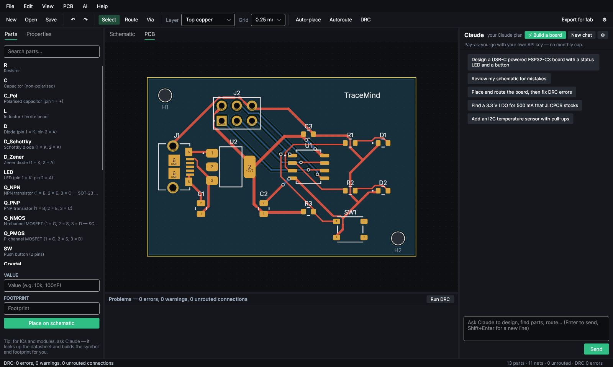

# TraceMind

AI-assisted PCB design for Windows. Describe a board and Claude does the rest: it researches real parts on the web, draws the schematic, places and routes the PCB, and checks it. You can edit everything by hand.

The AI can run on **the Claude plan you already have** (Pro / Max) through Claude Code, with nothing extra to pay. Or it can use an Anthropic API key, which is billed per use.



## What it does

| | |
|---|---|
| **⚡ Build a board** | Type a description ("ESP32-C3 sensor board, USB-C, BME280, 40×30 mm, JLCPCB assembly"). Claude picks parts (with LCSC numbers), builds the schematic with all support parts, sizes the board, places, routes, runs DRC and fixes errors. |
| **Find parts** | Claude searches distributors and datasheets on the web and records MPN, manufacturer, LCSC number and datasheet on each part. |
| **Routing** | A built-in grid autorouter that handles clearances, vias, net classes and rip-up/retry. Claude steers it: routing order, power widths, which nets a pour handles, and layer locks. Power nets keep full width where there's room and narrow in tight spots. When a net fails, the router reports exactly where it's blocked. |
| **Single-sided / CNC** | 1-layer boards (top or bottom copper). Wire links (2 mm pads, 1 mm drill, 0.3/0.4/0.5") are inserted automatically where nets must cross. CNC export uses a lower-left origin and can mirror the bottom side. |
| **Claude edits copper** | Claude can see the board (a list plus an image with rulers), draw tracks point by point, move or delete tracks, set per-segment widths, and add vias, wire links and mounting holes. |
| **Review** | Ask Claude to review the design. It reads the full netlist and layout and checks for missing decoupling, floating pins, DRC problems and similar issues. |
| **Schematic editor** | Symbols, wires, net labels, no-connect flags, net highlighting, undo/redo, auto-tidy. |
| **PCB editor** | Placement (move, rotate, flip, lock), interactive 45° routing with vias, copper pours, ratsnest, DRC markers, 2 or 4 layers. |
| **Footprints** | Parametric library (0402–2512, SOT-23/223/89, SOIC/TSSOP/MSOP/SSOP, DIP, QFN, TQFP/LQFP, headers, JST, USB, crystals, switches…). Claude builds custom footprints from datasheet land patterns. |
| **Manufacturing** | Gerber X2 for all layers, Excellon drill (PTH and NPTH), BOM and CPL in JLCPCB format, zipped and ready to upload. |
| **KiCad** | Open, edit and save back `.kicad_pcb` boards (KiCad 7/8/9 format, keeps a `.bak`), and import and export KiCad netlists. Optionally exports through `kicad-cli`. |

## Getting started

1. Download `TraceMind.exe` from the latest release (or the `build` workflow artifact) and run it. It needs no install or .NET runtime.
2. Connect Claude, using either option:
   - **Your Claude plan (recommended):** install Claude Code by opening PowerShell and running `irm https://claude.ai/install.ps1 | iex`. Then run `claude` once and sign in with your Claude account. TraceMind finds it automatically, and usage counts toward your plan's normal limits.
   - **API key:** in **⚙ Settings**, choose the API option and paste a key from [console.anthropic.com](https://console.anthropic.com).
3. Click **⚡ Build a board**, or try **File → New from example**.

### Cost

- **Claude plan:** there's no extra charge. Big "build a board" runs use a fair share of your plan's usage limits.
- **API key:** each request is billed at API prices, and the chat header shows a running estimate. To spend less, pick Sonnet or Haiku in Settings.

## Building from source

Requires the .NET 8 SDK.

```
dotnet test tests/TraceMind.Tests
dotnet run --project src/TraceMind.App
dotnet publish src/TraceMind.App -c Release -r win-x64 --self-contained true -p:PublishSingleFile=true -o publish
```

`tools/Screenshots` renders the real window off-screen to PNGs. It's useful for checking UI changes on machines without a display.

## Project layout

```
src/TraceMind.Core   data model, netlist, DRC, autorouter, placer, Gerber/drill/BOM, KiCad I/O
src/TraceMind.AI     Claude agent (Anthropic C# SDK) and the design tools it calls
src/TraceMind.App    Avalonia desktop app (schematic + PCB editors, chat)
tests/               unit + integration tests (routing, DRC, exports, agent loop against a mock API)
```

## Keyboard

Schematic: `W` wire, `L` label, `Q` no-connect, `R` rotate, `M` mirror, `Del` delete.
PCB: `X` route, `V` via while routing, `R` rotate, `F` flip, `L` lock, `PgUp/PgDn` layer, `Ctrl+R` autoroute, `Ctrl+D` DRC.
Everywhere: wheel to zoom, middle or right drag to pan, `F` to zoom to fit.

## Known limitations

- Copper pours have solid connections (no thermal reliefs) and don't remove isolated islands.
- KiCad schematic files (`.kicad_sch`) can't be opened or edited yet. Use a netlist or `.kicad_pcb`.
- Copper zones, arcs and custom-shaped pads in imported KiCad boards are simplified (arcs become short segments; custom pads become rectangles).
- The autorouter works on a grid. It's good for typical 2-layer hobby and prototype boards, but not for high-speed or length-matched routing.
